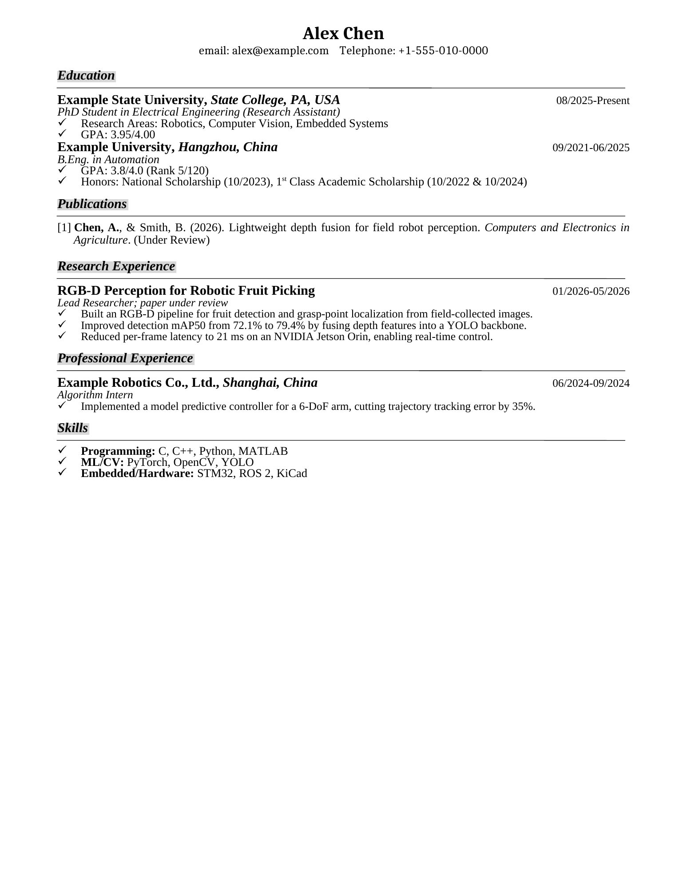
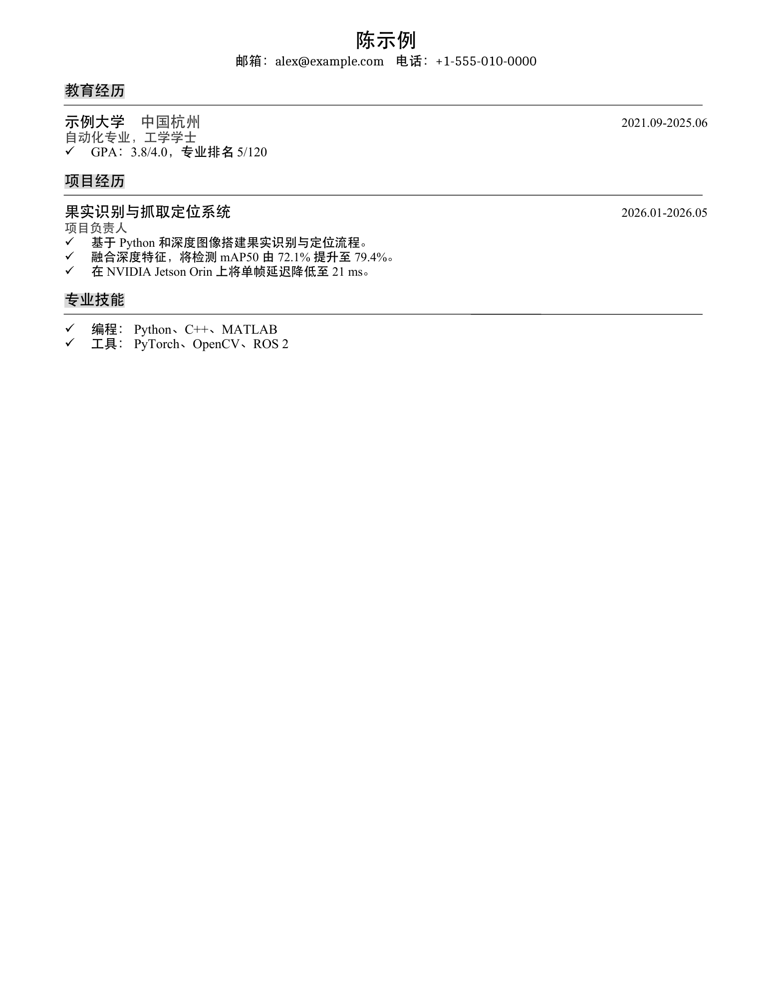

# Resume Builder

An AI skill for writing, tailoring, and reviewing English and Chinese resumes/CVs with YAML-driven Word templates.

Resume Builder separates content from formatting: an assistant helps organize and refine the facts you provide, while Python scripts build an editable `.docx` from structured YAML and reusable Word templates. The workflow requires asking for missing facts or marking placeholders instead of inventing achievements.

## Features

- Write or update resumes and academic CVs, and tailor content to a target role.
- Combine heuristic formatting checks with a structured content review.
- Use dedicated English and Chinese templates and writing guidance.
- Keep a master YAML and separate versions for different applications.
- Generate PDF/PNG previews using LibreOffice and Poppler.

## Example output

Fictional examples rendered with LibreOffice; the Chinese preview uses an available CJK fallback font.




## Quick start

Requires Python 3.10 or newer. Run from this repository's root:

```bash
python3 -m venv .venv
source .venv/bin/activate
python3 -m pip install -r requirements.txt
mkdir -p outputs
python3 scripts/build_resume.py examples/example_resume.yaml outputs/example_en.docx
python3 scripts/build_resume.py examples/example_resume_zh.yaml outputs/example_zh.docx
python3 scripts/check_resume.py outputs/example_en.docx --max-pages 2
python3 scripts/render_preview.py outputs/example_en.docx outputs/preview
```

On Windows, activate the environment with `.venv\Scripts\activate` and use `python` if appropriate. Install LibreOffice and Poppler separately and put `soffice` (or `libreoffice`), `pdfinfo`, and `pdftoppm` on PATH. They are required for previews; without them the checker reports that page counting was skipped. Pandoc is optional for extracting existing DOCX content. PDF input needs a separate PDF extraction tool; the builder accepts YAML only.

The Chinese template requests 等线 (DengXian). Install an appropriate CJK font or regenerate the template with an available font using `make_cjk_variant.py --font FONT_NAME`. Fonts are not included. If a headless renderer shows boxes despite installed fonts, configure its font discovery (for fontconfig-based builds, use `FONTCONFIG_FILE` pointing to a configuration with your system font directories and a suitable CJK fallback), then rerender and inspect all pages. Font substitution can change line breaks and pagination.

## Use as a skill

The folder contains a standard `SKILL.md` entrypoint and is prepared for local Codex installation. Copy the complete `resume-builder` folder into your Codex skills directory (typically `~/.codex/skills/`). Invoke `$resume-builder`, or ask for a resume task. See the [official skill example](https://developers.openai.com/blog/eval-skills) for the user-scoped folder convention.

The original workflow targeted Claude. A host that supports filesystem-based skills, Python execution, and document tools can use these instructions, but each host's installation and tool permissions differ. Other hosts have not been independently verified in this release.

Example requests:

- “Use $resume-builder to create an English CV from these facts. Ask about missing dates.”
- “检查这份简历，先给修改建议，不要重写。”
- “为这个职位生成中英文版本，不要编造指标。”

## Files

```text
SKILL.md                  assistant workflow
assets/                   English and Chinese Word templates
examples/                 fictional English and Chinese YAML
references/               writing rules, data format, review checklist
scripts/                  build, check, preview, template conversion
tests/                    build, privacy and input-validation checks
requirements.txt          Python dependencies
LICENSE                   MIT license
```

For a GitHub repository description: “An AI skill for writing, tailoring, and reviewing English and Chinese resumes/CVs with YAML-driven Word templates.”

See [data format](references/data-format.md) for supported sections, inline markup, and custom templates. Custom templates must preserve the documented paragraph markers and run structure.

## Limitations

- Formatting is template-based; pixel-identical output across Word, LibreOffice, fonts, and operating systems is not guaranteed.
- Checks primarily inspect body paragraphs and directly numbered lists. Table-based resumes and inherited styles may be missed.
- Spelling and wording checks are mostly English-oriented. Numbers in bullets are only clues, not proof of quantified impact.
- The checker does not verify facts or certify ATS compatibility. Review the rendered pages manually.
- Word comments and tracked changes require separate document-editing tools; they are not built into these scripts.
- A check report is advisory and does not return a failing exit code merely because it found resume issues. Execution errors do return a failure.

## Validation

Run `python3 -m unittest discover -s tests -v`. The release was checked with Python 3.12 on macOS: English/Chinese generation, metadata checks, invalid-input rejection, date ordering, and LibreOffice rendering. CJK previews require an installed CJK font; minimal headless environments may need additional font discovery configuration. Other platforms and Microsoft Word were not tested.

## Privacy

All bundled examples are fictional. Templates have been stripped of personal core properties and custom document properties. The Python scripts do not send resume content to a network service; an AI host's handling of uploaded content depends on that host.

Keep real resume data in `private/` and generated files in `outputs/`, both ignored by Git. Ignore rules are a convenience, not a privacy scanner. Before sharing a custom template or output, check its metadata, links, comments, revisions, and embedded files.

## License

MIT; see [LICENSE](LICENSE). The license covers the code, documentation, and bundled original templates. Third-party dependencies and fonts retain their own licenses.
